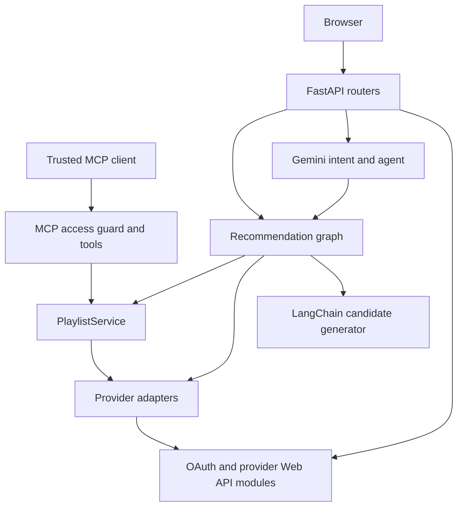

# Backend Code Explained

Related guides: [Frontend](frontend_README.md), [MCP](mcp_README.md),
[LangChain and LangGraph](langchain_langgraph_README.md).

## 1. Architecture and Reading Order

The backend is one FastAPI application with provider-specific OAuth/API adapters,
a shared playlist draft service, Gemini conversational services, a LangGraph
recommendation workflow, and a mounted trusted-client MCP sub-application.



Read [main.py](../backend/main.py), the matching router, its service, the shared
models, provider adapter, and Web API helper in that order. Python comments are
placed alongside source statements; multiline string bodies remain literal text.
Package `__init__.py` files mark importable directories and perform no initialization.

## 2. Entry Point and Process Lifetime

[main.py](../backend/main.py) constructs `app`, adds CORS, registers Spotify,
login, Gemini, music, and YouTube routers, and mounts MCP at `/mcp`. The lifespan
context runs the MCP session manager for the same lifetime as FastAPI.

`GET /` and `/health` check process reachability only. They do not validate
provider permissions, model availability, OAuth configuration, or YouTube quota.
CORS permits the localhost and 127.0.0.1 Vite origins on port 5173, credentials,
all methods/headers, and exposes Retry-After. CORS is a browser policy, not API
authentication for arbitrary clients.

The playlist service is a process-local singleton. Use one worker for the current
design: multiple workers do not share drafts or MCP sessions. Restart/reload loses
that state. There is no database or durable queue.

## 3. Complete File Map

| File | Purpose |
| --- | --- |
| [login/router.py](../backend/login/router.py) | GET Spotify login and callback route bindings. |
| [login/service.py](../backend/login/service.py) | Spotify OAuth config, state generation/cookie, callback validation, token handoff. |
| [spotify/router.py](../backend/spotify/router.py) | Bearer dependency, token/profile/playlists, legacy recommendations, and low-level writes. |
| [spotify/web_api.py](../backend/spotify/web_api.py) | Request models, OS-backed TLS, provider error mapping, token exchange, search, read/write helpers. |
| [spotify/service.py](../backend/spotify/service.py) | Compatibility `recommend_songs` wrapper around structured generation and quantity extraction. |
| [youtube/router.py](../backend/youtube/router.py) | Google OAuth routes, profile/channels/playlists, validated explicit CRUD endpoints. |
| [youtube/service.py](../backend/youtube/service.py) | OAuth state, S256 PKCE, fragment handoff, no-store and cookie cleanup. |
| [youtube/web_api.py](../backend/youtube/web_api.py) | Google tokens/userinfo plus YouTube Data API, sanitized reason mapping, pagination, search, writes. |
| [youtube/provider.py](../backend/youtube/provider.py) | Shared provider interface implemented using videos and playlist-item writes. |
| [gemini_setup/conversation.py](../backend/gemini_setup/conversation.py) | Validated conversation text and history serialization. |
| [gemini_setup/service.py](../backend/gemini_setup/service.py) | Intent classification, direct SDK calls/fallbacks, and NDJSON streaming. |
| [gemini_setup/router.py](../backend/gemini_setup/router.py) | HTTP contracts and exception translation for agent/intent/text endpoints. |
| [gemini_setup/agent.py](../backend/gemini_setup/agent.py) | Intent-first playlist execution or ordinary conversational response. |
| [gemini_setup/main.py](../backend/gemini_setup/main.py) | Small standalone SDK demonstration guarded by `__name__ == '__main__'`, not the ASGI server. |
| [models/song_details_model/songsdetails.py](../backend/models/song_details_model/songsdetails.py) | Model-generated SongDetails and branded SongRecommendations. |
| [music/models.py](../backend/music/models.py) | Shared proposal, catalog match, draft preview, and creation result contracts. |
| [music/constraints.py](../backend/music/constraints.py) | Explicit user count/duration parsing and bounds. |
| [music/providers.py](../backend/music/providers.py) | Spotify resolution, normalization, recording evidence, and provider protocol. |
| [music/service.py](../backend/music/service.py) | Sessions, ownership, expiry, selection, approval, locks, and uncertain-write state. |
| [music/router.py](../backend/music/router.py) | Shared HTTP recommendations/drafts/approval/create/session endpoints. |
| [music/mcp_server.py](../backend/music/mcp_server.py) | Guarded FastMCP tools and transport wrapper. |
| [music/client.py](../backend/music/client.py) | Trusted Python MCP client and Spotify session bootstrap. |
| [recommendations/langchain_model.py](../backend/recommendations/langchain_model.py) | Structured model boundary and distinct-candidate validation. |
| [recommendations/langgraph_workflow.py](../backend/recommendations/langgraph_workflow.py) | Bounded recommendation repair graph. |

## 4. Spotify OAuth Setup and Internals

Register a Spotify application with a redirect URI exactly matching
`SPOTIFY_REDIRECT_URI`, for example the backend's `/callback`. Configure
`SPOTIFY_CLIENT_ID` and `SPOTIFY_CLIENT_SECRET` server-side. The frontend's callback
is different: `FRONTEND_CALLBACK_URL` defaults to `/auth/callback` on port 5173.

`_spotify_config` refuses incomplete configuration with 503. `spotify_login`
creates a cryptographically random state, encodes the authorization URL, and sets
a 10-minute HttpOnly, SameSite=Lax state cookie. Secure is enabled when the
configured redirect URI uses HTTPS.

The scopes request private/email profile, private/collaborative playlist reads,
and private/public playlist modification. The callback rejects denied or missing
codes, checks state with constant-time comparison, and exchanges the code
server-side. `get_tokens` uses Basic client credentials with a form body; refresh
does not require the original code. An omitted refresh token during refresh is
filled with the previous refresh token.

The backend redirects to the frontend with whitelisted token fields in a fragment,
deletes the state cookie, and sets no-store/no-referrer. This development handoff
does not create a server-side Playit login session or make tokens HttpOnly.

## 5. Google/YouTube OAuth Setup and Internals

Enable YouTube Data API v3 in the OAuth client's Google Cloud project. Configure a
Web application client with `GOOGLE_CLIENT_ID`, `GOOGLE_CLIENT_SECRET`, and
`YOUTUBE_REDIRECT_URI` matching the backend `/youtube/callback`. Register consent
scopes and test users while the app is in testing. Set
`YOUTUBE_FRONTEND_CALLBACK_URL` for the browser's `/auth/youtube/callback` if needed.

`youtube_login` creates state plus a random verifier. The SHA-256 verifier digest,
base64url-encoded without padding, becomes the S256 challenge. Only the challenge
goes to Google; verifier and state stay in 10-minute HttpOnly cookies under
`/youtube`. Login requests account selection, consent, offline access, and
incremental granted scopes.

Scopes are `openid email profile` and `youtube.force-ssl`. Refreshing a read-only
token does not add write permission; reconnect and grant the new scope. The
callback validates state/verifier, exchanges the code, filters token fields, and
clears both cookies on handled success/failure. ID tokens are not forwarded as a
Playit identity. Google userinfo is an account profile; it is not a channel lookup.

No usable channel, disabled API, insufficient scopes, expired tokens, and project
quota limits have distinct sanitized messages. A successful Google login does
not prove YouTube writes will succeed. Refresh tokens can be absent; external
apps in testing can have short-lived offline grants under Google's policies.

## 6. HTTP Route Reference

### Root, OAuth, and Gemini

| Method and path | Meaning |
| --- | --- |
| GET `/`, `/health` | Process probe. |
| GET `/spotify/login` | Start Spotify authorization. |
| GET `/callback` | Spotify authorization callback. |
| GET `/youtube/login`, `/youtube/callback` | Start/finish Google authorization. |
| POST `/gemini/intent` | Return validated `chat` or `playlist`; does not approve writes. |
| POST `/gemini/agent?provider=...` | Bearer required; classify intent, prepare actual draft or reply. |
| POST `/gemini/interactions` | Completed SDK text response. |
| POST `/gemini/interactions/stream` | NDJSON status/delta/done/error stream. |

### Shared playlist workflow

All routes below accept a bearer access token; ordinary music routes use the
selected provider's token, but session bootstrap currently verifies Spotify `/me`.

| Method and path | Input and result |
| --- | --- |
| POST `/music/recommendations?provider=spotify|youtube` | ConversationRequest; returns preview plus model-only context after graph repair. |
| POST `/music/drafts` | Caller-supplied PlaylistProposal; resolves once without LangChain/LangGraph repair. |
| GET `/music/drafts/{draft_id}` | Owner-only preview and recorded creation result. |
| POST `/music/drafts/{draft_id}/approve` | Explicit approval, 204; unmet constraints or zero matches reject with 409. |
| POST `/music/drafts/{draft_id}/create` | Requires approval; returns recorded result or attempts first creation. |
| POST `/music/sessions` | Spotify profile verification, then a short-lived MCP application-session handle. |

### Spotify compatibility and direct APIs

| Method and path | Meaning |
| --- | --- |
| POST `/spotify/token` | Code exchange with state cookie or refresh grant. |
| GET `/spotify/me` | Current Spotify profile. |
| GET `/spotify/users/{user_id}/playlists` | Aggregates bounded pagination against a fixed Spotify URL. |
| GET `/spotify/health` | Local provider-router probe. |
| POST `/spotify/recommendations` | LangChain candidates only, no catalog repair/draft; does not require Spotify bearer. |
| POST `/spotify/users/{user_id}/create_playlist` | Direct create; implementation targets `/me/playlists`, not arbitrary user writes. |
| POST `/spotify/add_item/{playlist_id}/items` | Direct authenticated URI insertion. |
| POST `/spotify/remove_item/{playlist_id}/items` | Legacy incomplete removal implementation; not used by draft flow. |
| PUT `/spotify/update_item/{playlist_id}/items` | Legacy incomplete reordering implementation; not used by draft flow. |

### YouTube direct APIs

| Method and path | Meaning |
| --- | --- |
| POST `/youtube/token` | Code+PKCE exchange or refresh; handled failures also get no-store headers. |
| GET `/youtube/me` | Google account profile. |
| GET `/youtube/channels` | One channel page; optional page_token/max_results. |
| GET `/youtube/playlists` | One playlist page; optional page_token/max_results. |
| GET `/youtube/health` | Local provider-router probe. |
| POST `/youtube/create_playlist` | Create an empty playlist, 201. |
| PUT `/youtube/update_playlist/{playlist_id}` | Replace name/description; preserve omitted privacy. |
| DELETE `/youtube/delete_playlist/{playlist_id}` | Permanent deletion, 204. |
| POST `/youtube/add_item/{playlist_id}/items` | Insert one video and return playlist-item data, 201. |
| DELETE `/youtube/remove_item/{playlist_item_id}/items` | Remove an insertion by playlist-item ID, not video ID, 204. |

Direct provider write routes do not implement the shared draft approval gate.
They are compatibility/explicit APIs, not model tools; their callers must obtain
confirmation separately. Do not expose them to an untrusted agent as safe tools.

## 7. Data Models and Validation

| Model | Fields and purpose |
| --- | --- |
| ConversationTurn | `role` user/assistant; nonblank stripped `text`, maximum 10,000 characters; rejects extra fields. |
| ConversationRequest | Nonblank prompt, at most 20 history turns, 40,000 total historical characters. |
| SongDetails | Model-generated songname, artistname, genre, language, mood, release_date; extra fields forbidden; metadata is not provider verification. |
| SongRecommendations | Branded metadata plus message/candidates and server-owned requested_count/target_duration_ms. |
| RecommendedSong | title/artist, each 1-200 chars; aliases accept songname/artistname. |
| PlaylistMetadata | Name maximum 100 chars and description maximum 300; validators remove repeated suffixes, truncate safely, append `-Playit` and `created via Playit`. |
| PlaylistProposal | Provider enum, private default, 1-200 songs, optional count/duration constraints. |
| ResolvedTrack | Provider ID/URI, actual title/artists, optional positive duration. |
| SongMatch | Original recommendation plus matched/not_found/ambiguous/duplicate/not_selected and optional track. Not every status is currently emitted by every adapter. |
| PlaylistPreview | Owner-readable proposal/matches, count, expiry, approval/result, actual duration, warning. |
| PlaylistResult | Playlist ID/link, confirmed added count, total, partial/complete/needs_review. |
| RecommendationPreview | Preview plus independent model-generated context_text. |

Spotify request models distinguish authorization_code from refresh_token and
validate the necessary fields. URI insertion caps a batch at 100. YouTube
models constrain resource IDs, privacy enum, video IDs, positions, and metadata.

## 8. Explicit Count and Duration Parsing

`requested_quantity` examines user history then the current prompt, never model
responses. It folds number words through twenty, recognizes half an hour,
song/track quantities, selected corrective phrases, and hours/minutes. New
explicit quantities can replace previous constraints. Both can coexist when
specified together in a turn.

Bounds are 1-200 songs and 1 minute-8 hours. This is a bounded regex parser,
not a full natural-language time engine. Ambiguous requests can need refinement;
do not silently expand supported syntax when merely editing comments.

## 9. Catalog Matching: Spotify

`MusicProvider` is a Protocol describing `resolve`, `create`, `add`, and
`playlist_url`. SpotifyProvider implements it with the Web API.

| Helper | Why it exists |
| --- | --- |
| `normalize` | Case-fold and normalize Unicode while retaining non-Latin vowel marks and removing Latin accent differences. |
| `title_key` | Strip known catalog decorations such as film/feature/remaster labels, not meaningful alternate editions. |
| `artist_keys` | Split combined credits and preserve the full credit as a possible key. |
| `strip_artist_prefix` | Remove artist-title prefixes only with matching credit evidence. |
| `spelling_key`, `spelling_match` | Bound typo/romanization tolerance; avoid unrelated fuzzy title matches. |
| `title_score` | Rank exact, subtitle, and bounded alias matches while checking edition/duet evidence. |
| `same_recording` | Collapse reissues using normalized title/artists and matching ISRC; fallback to near-equal duration with stronger credit agreement. |
| `candidate_rank` | Prefer title quality, requested credit coverage, then album/single over compilation. |
| `best_recordings` | Retain best-ranked distinct recordings without arbitrary popularity scoring. |

`resolve` sanitizes model filter punctuation, tries up to four distinct bounded
queries, rejects malformed/unplayable/local/restricted results, and requires
artist evidence. Exact-title matches can return early; aliases wait for remaining
queries so later exact matches can win. Ties preserve upstream first-best order.
Track IDs are verified before making Spotify URIs. This is identity matching,
not a personalized recommender score.

## 10. Catalog Matching: YouTube

`search_videos` performs one category-10 music search with at most five videos,
then a metadata request. It checks video IDs, public/processed status and nonlive
content, then restores original search order. It does not paginate searches or
fan out alternative queries because search consumes quota.

`contains_phrase` checks word boundaries. `YouTubeProvider.resolve` normalizes
HTML-decoded title/channel, requires the requested phrase and artist evidence,
rejects unsolicited alternate editions, prefers a matching artist Topic channel,
then official audio/official labels, and keeps the first tie. ISO-like video
duration is converted to milliseconds when parseable. The resulting artists list
contains uploader/channel names, not verified performer credits.

Create maps shared privacy to public/private. Add inserts one video at a time.
YouTube video playlists are not a dedicated YouTube Music integration.

## 11. PlaylistService Method by Method

| Method/state | Behavior |
| --- | --- |
| Draft dataclass | Stores owner hash, proposal, verified matches, monotonic expiry, approval flag, recorded result, and per-draft asyncio lock. |
| `providers` | Registry maps spotify/youtube to their adapters. |
| `drafts`, `sessions` | In-memory dictionaries, each bounded at 500 entries after pruning. |
| `prune` | Removes expired entries; retains locked drafts during an active operation. |
| `connect` | Creates opaque session handle for a provider token, current bootstrap limited to Spotify. |
| `session_token` | Looks up unexpired token or raises 401. |
| `owner` | SHA-256 fingerprint binds a draft to the exact bearer token. It is not a stable user ID. |
| `draft` | Expiry/ownership check using compare_digest; inaccessible drafts look like 404. |
| `prepare` | Resolve supplied songs sequentially, then store a selected draft. |
| `select_matches` | Deep-copy matches, deduplicate provider IDs, then optionally select a duration subset without mutating graph state. |
| `prepare_resolved` | Accept internally verified matches; enforce capacity and store a 15-minute draft. Not an HTTP or model tool. |
| `preview` | Calculate selected count/duration, seconds remaining, warnings, and current creation state. |
| `approve` | Reject warnings or zero usable matches; set approved only after these checks. |
| `create` | Lock, check approval, return any recorded result, otherwise create/add once and preserve uncertain outcomes. |

Sessions last 50 minutes. Drafts last 15 minutes. Refresh/login changes the bearer
and therefore owner hash; old drafts may become inaccessible. Timestamps use
monotonic time to avoid wall-clock jumps.

Duration selection is bounded subset-sum in five-second units. States map
rounded total/count to chosen indices. It avoids selections over target+600
seconds and respects exact requested count when present. It selects the nearest
whole-track total, not a clipped mix. Actual totals outside 30 seconds of target
remain warnings and block explicit-constraint approval.

Before writes, create records `needs_review` to prevent retries after uncertain
timeouts. Once a playlist ID exists it stores the URL and increments confirmed
insertions. Spotify batches at 100, YouTube at one. On failure it does not delete
the provider playlist or roll back confirmed items. The lock/idempotency is
process-local and does not survive restart.

## 12. Gemini and Streaming Services

`classify_request` centralizes Agent and REST intent rules. It parses the SDK's
JSON response and accepts only playlist/chat. It does not grant approval.
`run_agent` awaits classification in a worker thread, prepares a playlist directly
for playlist intent, and returns the actual draft ID; chat uses native async SDK
generation. `_conversation_contents` maps assistant to Gemini's model role.

`create_interaction` is synchronous and tries the primary plus configured/default
fallbacks with a ten-second attempt timeout. Legacy fallback settings apply here,
not to the separate LangChain recommender. It currently prints/logs upstream
failures; logs should remain server-side and be reviewed before production use.

`create_stream_response` returns NDJSON with no-cache and X-Accel-Buffering=no.
`stream_events` emits waiting status, text deltas, done, or a sanitized error,
and closes the upstream generator. `stream_interaction` yields text parts but
excludes thought parts. Partial stream failure cannot change an already-sent
HTTP status, so clients must inspect error events.

## 13. Web API Reliability and Known Limitations

Both providers use verified TLS via truststore and optional SSL_CERT_FILE/DIR.
Do not fix certificates by setting verify=False. HTTP timeouts become 504,
connection failures 502, upstream 5xx generally 502, and provider 401/403/429 are
preserved with sanitized messages and Retry-After where present.

Spotify pagination reconstructs the fixed URL with offsets instead of following
an arbitrary upstream next URL with credentials. YouTube uses native page tokens
and returns one page per call. Writes are not automatically retried.

The legacy Spotify removal/reorder helpers reference fields such as
`request.access_token` and `range_before` absent from their models. Their routes
also lack the bearer dependency used by the safe flow. They are not working
examples to copy. This comments/documentation change preserves them and records
the limitation rather than silently changing behavior.

Model routes and provider routes are not protected by a full production Playit
session/rate-limiting system. Bearer presence is not local signature validation;
upstream calls establish provider token validity. Review deployment security
before exposing this development application publicly.

## 14. Configuration and Dependencies

| Variable | Purpose |
| --- | --- |
| SPOTIFY_CLIENT_ID / SPOTIFY_CLIENT_SECRET | Spotify confidential application credentials. |
| SPOTIFY_REDIRECT_URI | Backend Spotify callback registered with Spotify. |
| FRONTEND_CALLBACK_URL | Browser Spotify callback destination. |
| GOOGLE_CLIENT_ID / GOOGLE_CLIENT_SECRET | Google Web application OAuth client. |
| YOUTUBE_REDIRECT_URI | Registered backend Google callback. |
| YOUTUBE_FRONTEND_CALLBACK_URL | Browser YouTube callback destination. |
| GEMINI_API_KEY or GOOGLE_API_KEY | Server-side Gemini API key; first name takes precedence. |
| GEMINI_PRIMARY_MODEL | Primary model for SDK calls and structured generation. |
| GEMINI_FALLBACK_MODELS | Comma-separated fallback list for legacy SDK interactions. |
| GEMINI_FALLBACK_MODEL | Additional legacy single fallback for those interactions. |
| PLAYIT_MCP_API_KEY | Trusted MCP application credential of at least 32 characters. |
| SSL_CERT_FILE / SSL_CERT_DIR | Optional extra CA trust configuration. |

The current frontend has hardcoded Axios API hosts; setting an invented Vite API
variable alone will not change those modules. Use `.env` locally but never copy
its real contents into comments, guides, or commits. dotenv loads local settings
at import in relevant service modules; runtime deployment can supply environment
variables instead.

[requirements.txt](../backend/requirements.txt) is a pinned environment-style list,
including direct and transitive packages, not a minimal set of top-level needs:

| Group | Packages and reason |
| --- | --- |
| API/ASGI | fastapi, starlette, uvicorn, uvloop, httptools, websockets, watchfiles, multipart support. |
| HTTP/TLS | httpx/httpcore/h11/anyio/sniffio; requests/urllib3/certifi; truststore; charset-normalizer/idna. |
| OAuth/crypto | google-auth, cryptography, cffi/pycparser, pyasn1/modules. |
| Model SDK | google-genai, googleapis-common-protos, protobuf, typing support. |
| Orchestration | langchain-google-genai, langgraph, langsmith, mcp, rapidfuzz. |
| Validation/settings | pydantic, pydantic_core, extra-types/settings, annotated-types, typing-inspection, email-validator/dnspython, python-dotenv. |
| CLI/tooling | fastapi-cli/cloud-cli, fastar, typer/click, shellingham, rich/rich-toolkit, Pygments, markdown-it-py/mdurl, Jinja2/MarkupSafe, detect-installer/agent-detector/distro/rignore. |
| Observability/utilities | opentelemetry API/SDK/exporters/protos/semantic conventions, sentry-sdk, tenacity, PyYAML, annotated-doc. Presence does not mean tracing is enabled by the application. |

The uvloop platform marker skips that dependency on Windows. Dependency versions
are not instructions to edit the installed package source. Backend ignore rules
exclude venvs, bytecode, secrets, logs, local databases, and tooling caches.

## 15. Run, Navigate, and Diagnose

```sh
cd backend
python3 -m venv .venv
source .venv/bin/activate
python -m pip install -r requirements.txt
python -m uvicorn main:app --reload
```

Open `http://127.0.0.1:8000/docs` for the current OpenAPI contracts. `python -m
uvicorn main:app` refers to backend main, not gemini_setup/main. Avoid additional
workers until shared state is persisted. Start the frontend separately with
`npm start` from its directory.

| Symptom | Follow the code |
| --- | --- |
| Invalid OAuth state | Hostname, cookie path/lifetime, callback URI, OAuth service checks. |
| 401 or 403 provider failure | Token expiry, granted scope, account/channel access. |
| YouTube disabled/quota error | Google project owning OAuth client; mapped upstream reason. |
| Missing review | Agent real draft_id and preview GET, or REST recommendation preview. |
| Structured recommendation failure | LangChain schema/model/network; see the graph guide. |
| 404 draft after refresh/restart | Owner fingerprint, 15-minute expiry, in-memory process state. |
| 409 approval | Count/duration warning or no usable tracks. |
| needs_review | Provider write may have succeeded; inspect the recorded draft and provider before any new attempt. |

No test suite is added here, following the earlier request to remove test cases.
Safe local checks include Python compilation, importing the app with configured
environment, inspecting OpenAPI, frontend build/lint, and manual preview without
approval. Creating, updating, or deleting provider playlists has real effects.