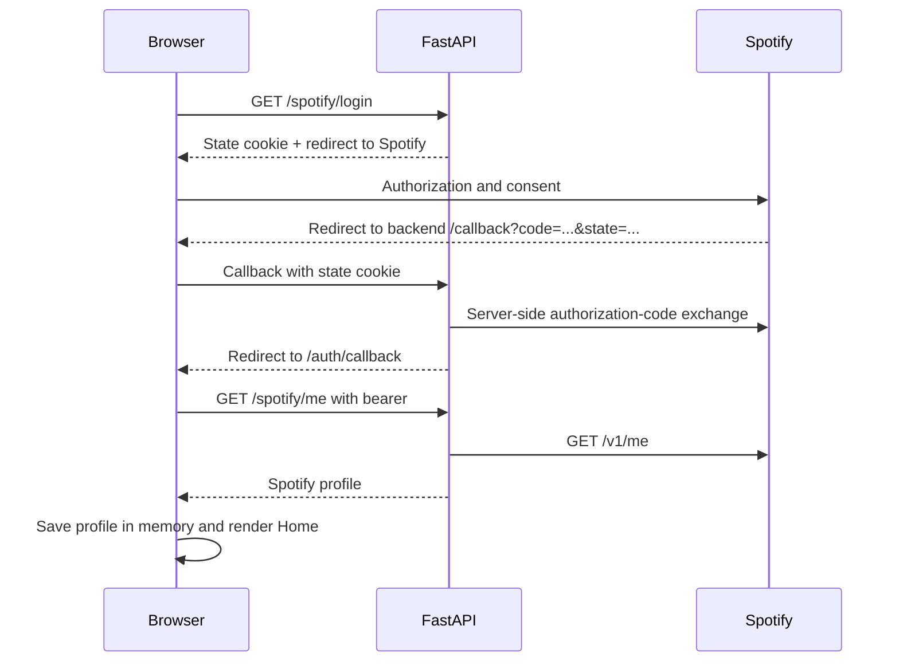
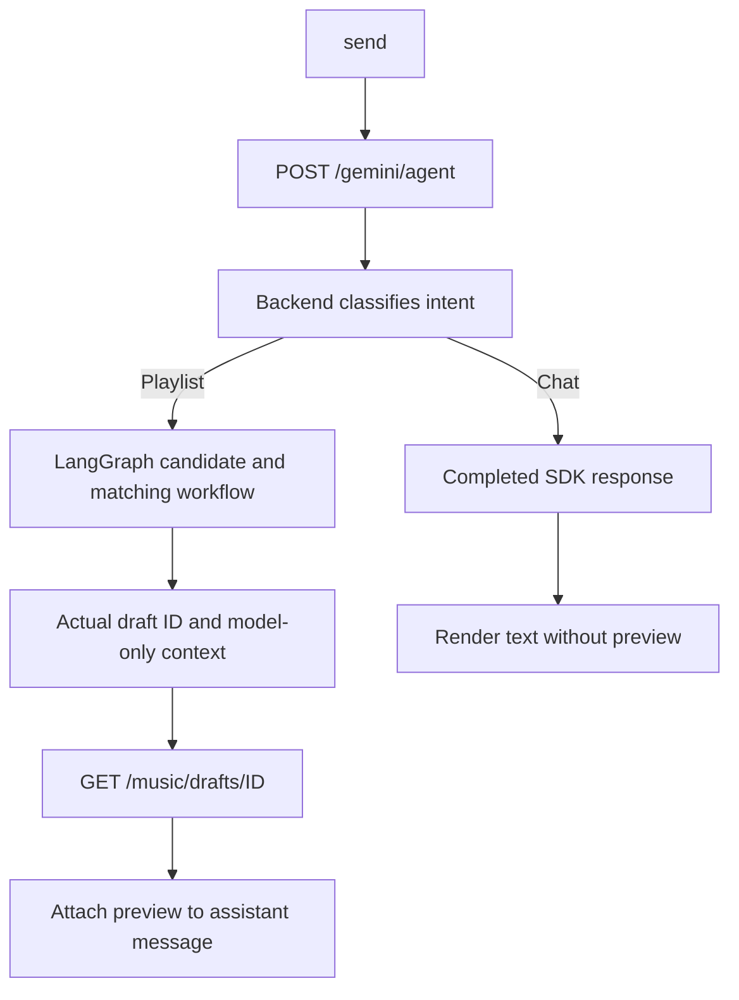

# Frontend Code Explained

This guide describes the code on the `code/explain` branch. Start here for the
browser application, then read [Backend](backend_README.md), [MCP](mcp_README.md),
and [LangChain and LangGraph](langchain_langgraph_README.md).

## 1. What the Frontend Does

Playit signs a user into Spotify or Google/YouTube, accepts a music request,
shows provider-verified song matches, and creates a playlist only after an
explicit approval click. It is a React single-page application, not a server-side
rendered site. Vite serves development modules and builds static production assets.

Three different kinds of state are intentionally separate:

| State | Owner | Lifetime |
| --- | --- | --- |
| Provider tokens/profile | In-memory auth module plus TanStack Query cache | Until logout or full page reload |
| Chat messages, draft previews, loading/errors | `useChat` | Until component unmount or page reload |
| Selected Agent/REST mode | Component state and localStorage | Can survive a page reload |

localStorage stores the mode, not OAuth tokens or conversation history. There is
no persisted chat database, automatic token-refresh timer, or real saved-chat UI.

## 2. Reading the Annotated Source

Brief comments sit next to the statements they explain. JSX uses comment
expressions that do not render visible text. Each code file ends with a short
`File summary` listing its role and main responsibilities in bullet points.

Blank lines and existing comments separate ideas; closing braces close the
scope opened above them. TypeScript type declarations are compile-time contracts
and do not become browser behavior. JSON and generated lockfile contents are not
modified to insert invalid comments; their settings are explained below.

## 3. Recommended Navigation Order

1. [HTML entry](../frontend/index.html) supplies the DOM root and module script.
2. [React entry](../frontend/src/main.tsx) mounts StrictMode and the error boundary.
3. [App](../frontend/src/App.tsx) installs the shared QueryClientProvider.
4. [Router](../frontend/Router/index.tsx) selects login, callback, or protected content.
5. [Home](../frontend/pages/Home/index.tsx) selects the provider and composes the layout.
6. [Chat](../frontend/Components/Chat/index.tsx) connects controls to `useChat`.
7. [useChat](../frontend/Components/Chat/useChat.ts) owns request and message state.
8. [musicApi](../frontend/src/lib/musicApi.ts) calls the backend's draft workflows.
9. [MessageList](../frontend/Components/Chat/MessageList.tsx) renders review and approval.

## 4. Component and File Map

| File | Responsibility and important details |
| --- | --- |
| [main.tsx](../frontend/src/main.tsx) | Calls `createRoot`; StrictMode may replay effects during development; full-page ErrorBoundary protects initial rendering. |
| [App.tsx](../frontend/src/App.tsx) | Creates one QueryClient outside the component so rerenders do not recreate the cache; wraps Router. |
| [App.css](../frontend/src/App.css) | Establishes global body/layout defaults used across pages. |
| [Router/index.tsx](../frontend/Router/index.tsx) | BrowserRouter handles client navigation; `/login`, `/auth/callback`, `/auth/youtube/callback` are public; `/` and fallback routes sit under ProtectedRoute. |
| [ProtectedRoute.tsx](../frontend/Router/ProtectedRoute.tsx) | Checks either provider's access-token presence; returns Outlet or Navigate to login. This is UI routing, not proof that the token is still valid upstream. |
| [Login](../frontend/pages/Login/index.tsx) | Provider buttons navigate the entire browser to backend login URLs; Google callback errors arrive via location state and `?error=youtube`. |
| [Spotify callback](../frontend/pages/AuthCallback/index.tsx) | Parses fragment credentials, stores them, requests the profile, clears the fragment after the effect settles, and navigates home. |
| [YouTube callback](../frontend/pages/YouTubeAuthCallback/index.tsx) | Captures the fragment in a ref before clearing it, accepts missing refresh tokens, requests Google profile, and gives more detailed sanitized failure feedback. |
| [Home](../frontend/pages/Home/index.tsx) | Combines Navbar, Sidebar, local ErrorBoundary, and Chat. Spotify wins if both token stores contain access tokens; otherwise YouTube is selected. There is no explicit account-switch control here. |
| [Navbar](../frontend/Components/Navbar/index.tsx) | Logout clears both auth stores and navigates to login. It does not revoke tokens at the provider. |
| [Sidebar](../frontend/Components/Sidebar/index.tsx) | Displays hard-coded example history. New Chat currently logs a click; it does not reset `useChat` or open a persisted conversation. |
| [Button](../frontend/Components/Button/index.tsx) | Renders a named button with a callback and optional secondary appearance; a presentation helper, not an API layer. |
| [Chat/index.tsx](../frontend/Components/Chat/index.tsx) | Displays welcome text, Agent/REST segmented controls, errors, public activity, message list, and composer. The mode cannot change while sending. |
| [ChatComposer](../frontend/Components/Chat/ChatComposer.tsx) | Owns unsent input; rejects blank/double submissions; Enter sends, Shift+Enter adds a line, IME composition is respected. Its input limit is 4,000 characters. Stop aborts the current client request. |
| [MessageList](../frontend/Components/Chat/MessageList.tsx) | Auto-scrolls only while near the latest message; renders Markdown, match statuses, duration warnings, approval, creation outcome, and provider links. |
| [ThinkingIndicator](../frontend/Components/Chat/ThinkingIndicator.tsx) | Expandable public progress events only. It does not reveal model chain-of-thought or a LangGraph execution trace. |
| [Chat/types.ts](../frontend/Components/Chat/types.ts) | Defines message role, lifecycle status, independent model-context text, and optional playlist state. |
| [useChat](../frontend/Components/Chat/useChat.ts) | Owns message arrays, request cancellation, history selection, Agent/REST branching, approval/creation, and failure recovery. |
| [ErrorBoundary](../frontend/Components/ErrorBoundary/index.tsx) | Class boundary catches rendering failures, logs details only in development, and offers retry/reload/login. Async API failures are handled by hooks instead. |
| [YouTubeLibrary](../frontend/Components/YouTubeLibrary/index.tsx) | Older, currently unmounted library view with channel queries, paginated playlists, reconnect, and manual refresh. Its read-only notice is stale relative to the active chat workflow. |

## 5. Spotify Login From Click to Chat



The client secret exists only in backend configuration. A fragment is not sent
to Vite in an HTTP request, but browser JavaScript can read it; this is not an
HttpOnly Playit session architecture. Use consistent backend hostnames during
login, because OAuth cookies are scoped to their host.

The Spotify callback currently requires access token, refresh token, token type,
and expiry. Its `cancelled` flag prevents obsolete async results from navigating
after unmount. A full reload clears the in-memory login.

## 6. YouTube Login From Click to Chat

The YouTube button navigates to `/youtube/login`. The backend sets state and PKCE
verifier cookies, redirects to Google consent, checks the returned state, and
exchanges the authorization code plus verifier. It redirects to
`/auth/youtube/callback#...` rather than the Spotify callback.

The callback stores Google credentials only in `youtubeAuth`, immediately removes
the fragment, and calls `/youtube/me`, which returns a Google account profile,
not a YouTube channel. Missing refresh tokens are valid after some repeated
authorizations. A new login does not reuse a previous account's refresh token.

The active Home page does not fetch channels just to sign in. Channel eligibility
and YouTube quota can still fail later when the provider is used. The underlying
integration is the official YouTube Data API, not an unofficial YouTube Music API.

## 7. Auth Modules and API Helpers

| Module | Functions and behavior |
| --- | --- |
| [auth.ts](../frontend/src/lib/auth.ts) | `readSpotifyAuthState` reads the module variable; `saveSpotifyAuthState` merges partial changes; `clearSpotifyAuthState` resets it; `useSpotifyAuth` subscribes through Query; action hooks update both module storage and Query cache. `staleTime: Infinity` does not make tokens immortal. |
| [youtubeAuth.ts](../frontend/src/lib/youtubeAuth.ts) | Separate Google auth shape and cache key; action hooks update memory/cache; clear also removes library channel/playlist queries. |
| [spotifyApi.ts](../frontend/src/lib/spotifyApi.ts) | Axios instance at `http://127.0.0.1:8000/spotify`; request interceptor adds Spotify bearer. Profile, playlists, code exchange, and refresh helpers return response data. Refresh is explicit, not scheduled. |
| [youtubeApi.ts](../frontend/src/lib/youtubeApi.ts) | Separate Axios instance at `/youtube`; interceptor excludes `/token` from access-token injection. Helpers cover profile, refresh, channels, paginated playlists, create/update/delete, and add/remove items. Direct writes are not executed automatically by chat. |
| [geminiApi.ts](../frontend/src/lib/geminiApi.ts) | JSON Axios instance at `/gemini`; `createGeminiInteraction` is the completed-response compatibility helper. |
| [chatApi.ts](../frontend/src/lib/chatApi.ts) | `getChatIntent` validates the action; `requestChatResponse` validates a completed response; `streamChatResponse` parses NDJSON incrementally. |
| [musicApi.ts](../frontend/src/lib/musicApi.ts) | `clientFor` chooses the selected provider's bearer interceptor; `preparePlaylist` calls `/music/recommendations`; `runPlaylistAgent` calls `/gemini/agent` then fetches the draft preview; `approveAndCreatePlaylist` sends approval before creation; `getPlaylistPreview` reads state; `musicErrorMessage` presents backend detail safely. |

The shared music base URL is derived from the Spotify Axios base URL but the
selected Axios instance still supplies the selected provider's token. IDs inserted
into paths are encoded. Provider selection is passed as a query parameter.

## 8. One Message's Lifecycle

1. Composer trims the input and calls `send` without waiting to keep the UI event handler simple.
2. `useChat` rejects a second active request and installs an AbortController in a ref.
3. It constructs bounded history from complete messages, excluding stopped/error/partial output.
4. It uses `contextText` rather than rendered catalog previews for assistant history when available.
5. It appends a user message and an empty assistant message with independent UUIDs.
6. A local `update` helper replaces only the assistant with that UUID.
7. Agent or REST logic fills text and possibly playlist state.
8. Catch marks stopped/error and displays errors; finally clears the active request and sending flag.

History has at most 20 turns, 10,000 characters per selected turn, and 40,000
characters total. Iterating backwards keeps recent messages, then `unshift`
restores chronological order. Tokens, actual catalog titles, provider IDs,
creation results, and progress events are not deliberately appended as model context.

Stopping the browser request does not guarantee a provider or already-running
model call was cancelled server-side. There are no automatic creation retries.

## 9. Agent Mode



Agent ordinary replies are completed responses, not the REST-mode NDJSON stream.
A claim in model text is not a draft: the frontend requires a real `draft_id`,
fetches its preview, and only then attaches playlist state. Backend preparation
errors propagate instead of being rewritten into fictional success text.

## 10. REST Mode and Streaming

REST mode first calls `/gemini/intent`. For `playlist`, it makes one
`/music/recommendations?provider=...` call returning preview plus `context_text`.
For `chat`, it streams `/gemini/interactions/stream` using `fetch`, not Axios.

The stream parser is important because network reads do not align with JSON
records or UTF-8 character boundaries:

1. A TextDecoder keeps incomplete UTF-8 bytes between chunks.
2. A string buffer keeps incomplete NDJSON records between reads.
3. Each newline-delimited nonblank record is JSON-parsed and shape-checked.
4. `status` adds public progress; `delta` appends answer text.
5. `error` throws; `done` requires actual text and ends the generator.
6. End-of-stream without `done` is a failure rather than silent success.
7. Finally cancels and releases the reader.

The route is not Server-Sent Events from the browser's perspective: its media
type is `application/x-ndjson`, even though upstream Gemini uses its own stream.

## 11. Review, Approval, and Creation

MessageList renders the preview only when `message.playlist` exists. It displays
model recommendation versus actual matched track, provider, privacy, matched
count, duration, warnings, and each status. YouTube artist rows are labeled as
uploaders because those credits are not verified performer identities.

The approval button is disabled while creating, with zero matches, or with a
constraint warning. The hook also uses a Set of message IDs to block double clicks.
It sends `/approve` then `/create`; these are two separate authenticated calls.
On failure, it re-reads the existing draft's result rather than making a new draft
or assuming the provider rejected a write. Complete results show provider links;
uncertain results require checking the provider manually.

Markdown allows GFM but skips raw HTML. Model-supplied images are replaced by
their alt text rather than causing external image loads. External links use
`noopener noreferrer`. These measures are not a substitute for backend auth.

## 12. Styles and Static Assets

| File(s) | Purpose |
| --- | --- |
| [Chat/index.css](../frontend/Components/Chat/index.css) | Chat flex/grid layout, scrolling message region, composer, modes, previews, progress pulse, responsive rules, reduced-motion treatment where defined. |
| [ErrorBoundary/index.css](../frontend/Components/ErrorBoundary/index.css) | Full-page versus local fallback layout, error actions, and responsive presentation. |
| [Home/index.css](../frontend/pages/Home/index.css) | Navbar/sidebar/content layout and mobile adjustments. |
| [Login/index.css](../frontend/pages/Login/index.css) | Login layout, typography, provider buttons, and error/notice spacing. |
| [Button/index.css](../frontend/Components/Button/index.css) | Shared primary/secondary button appearance. |
| [Navbar/index.css](../frontend/Components/Navbar/index.css) | Top-level navigation arrangement. |
| [Sidebar/index.css](../frontend/Components/Sidebar/index.css) | Placeholder chat list and sidebar presentation. |
| [YouTubeLibrary/index.css](../frontend/Components/YouTubeLibrary/index.css) | Styling for the older unmounted library view. |
| [icons.svg](../frontend/public/icons.svg) | Static symbol sprite: symbols have IDs/viewBoxes; paths are vector geometry; defs/clipPath constrain drawing. It does not execute login/chat logic. |
| [favicon.svg](../frontend/public/favicon.svg) | Static vector favicon asset, not an application module. |

Stylesheets intentionally remain unannotated. Media queries apply conditional
overrides; keyframes describe animation steps; a closing brace ends the
selector/query scope. Generated assets under `dist` are not source to edit.

## 13. Configuration Explained

### package.json and package-lock.json

`name` identifies the package, `private: true` prevents accidental publishing,
`version` is project metadata, and `type: module` selects ECMAScript modules.
The current scripts are `start` = Vite, `build` = TypeScript project build then
Vite production output, `lint` = ESLint, and `preview` = serve built assets locally.
Use `npm start`, not an assumed `npm run dev`, on this branch.

Runtime dependencies: React/react-dom render the UI; react-router-dom handles
routes; TanStack Query manages cached state/requests; Axios handles JSON APIs;
react-markdown and remark-gfm render assistant Markdown. Dev dependencies provide
Vite's React transform, TypeScript, browser/Node/React types, ESLint's JavaScript
and TypeScript rules, and React hook/refresh rules. The lockfile fixes the resolved
dependency graph and integrity metadata; update it through npm, not hand comments.

### TypeScript project files

[tsconfig.json](../frontend/tsconfig.json) has no direct files and references the
app and Node configurations. In [tsconfig.app.json](../frontend/tsconfig.app.json):

| Setting | Meaning |
| --- | --- |
| `tsBuildInfoFile` | Put incremental build metadata under ignored node_modules/.tmp. |
| `target`, `lib` | Check ES2023 APIs plus browser DOM types. |
| `module`, `moduleResolution` | Keep ES modules and resolve imports using bundler rules. |
| `types` | Load Vite's client environment declarations. |
| `allowArbitraryExtensions` | Permit bundler-supported nonstandard module extensions. |
| `skipLibCheck` | Skip typechecking dependency declaration internals. |
| `allowImportingTsExtensions` | Permit explicit `.ts`/`.tsx` import names. |
| `verbatimModuleSyntax` | Preserve import/export intent and type-only boundaries. |
| `moduleDetection` | Treat files as modules consistently. |
| `noEmit` | TypeScript checks; Vite emits browser assets. |
| `jsx` | Use the modern React JSX runtime. |
| `noUnusedLocals`, `noUnusedParameters` | Catch unused declarations/arguments. |
| `erasableSyntaxOnly` | Restrict TypeScript syntax to forms the toolchain can erase. |
| `noFallthroughCasesInSwitch` | Reject accidental switch fallthrough. |
| `include` | Start from src; imported components outside src enter the program through imports. |

[tsconfig.node.json](../frontend/tsconfig.node.json) checks Vite configuration with
Node types, no DOM library, NodeNext module semantics, and corresponding
no-emit/unused/erasable settings. Do not describe the project as having an explicit
`strict: true` setting: the checked-in app configuration does not declare it.

[vite.config.ts](../frontend/vite.config.ts) enables the React plugin; it does not
define an API reverse proxy. Backend URLs in Axios modules are currently hardcoded.
[eslint.config.js](../frontend/eslint.config.js) ignores dist and combines recommended
JavaScript, TypeScript, React hooks, and refresh rules with browser globals.
[.gitignore](../frontend/.gitignore) excludes logs, dependencies, builds, local
overrides, and editor/OS files. These are ignore patterns, not runtime settings.

## 14. Run and Explore Safely

```sh
cd frontend
npm install
npm start
```

Run the backend separately as described in [Backend](backend_README.md). The local
UI normally opens at `http://localhost:5173`; do not commit real OAuth fragments,
bearer tokens, or screenshots containing secrets.

Try a greeting, a five-song request, a language refinement, a duration request,
both modes, cancellation, and a preview without approving. Approval really writes
to the selected provider, so inspect the list before clicking. No test files are
introduced by this documentation branch.

## 15. Where to Change Things

| Desired change | Start here |
| --- | --- |
| Composer interactions or input size | ChatComposer |
| History selection, mode, cancellation | useChat |
| Preview rows/approval presentation | MessageList and Chat CSS |
| Model recommendation prompt | Backend LangChain module, not JSX |
| Match identity/ranking | Backend provider adapters |
| Provider auth storage | auth.ts / youtubeAuth.ts |
| Callback error handling | Matching callback page and backend OAuth service |
| API host | All Axios baseURL definitions; keep backend CORS aligned |
| Real sidebar conversations | New persistence/navigation design; currently only placeholders |

If review is absent, inspect `/gemini/agent` for a real draft ID and its subsequent
GET preview response, or `/music/recommendations` for `preview`. A sentence saying
"ready" cannot render an approval button without actual playlist state.