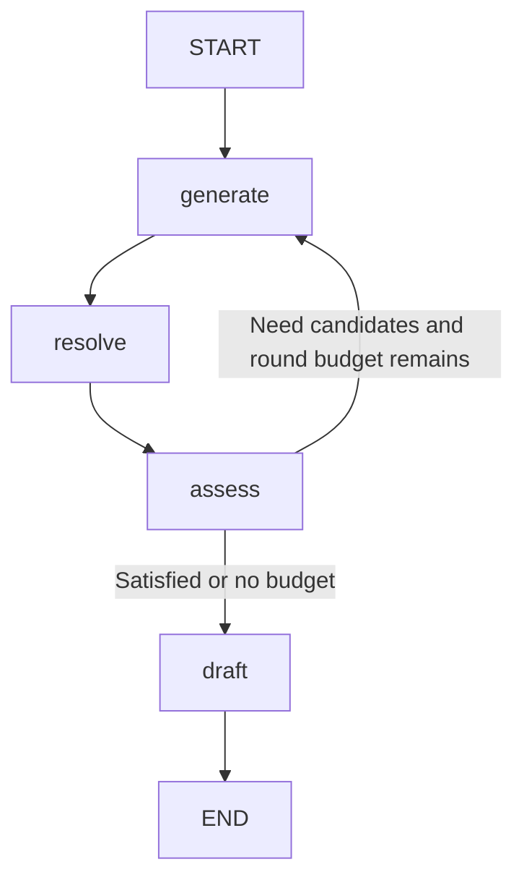

# LangChain and LangGraph Explained

Related guides: [Frontend](frontend_README.md), [Backend](backend_README.md),
[MCP](mcp_README.md).

## 1. Separate Responsibilities

| Layer | What it does | What it does not do |
| --- | --- | --- |
| Gemini SDK agent/services | Intent classification and conversational replies/streaming | Cannot approve playlists by saying yes in chat |
| LangChain model module | Configure Gemini and produce validated structured candidates | Does not search Spotify/YouTube or create playlists |
| LangGraph workflow module | Execute bounded generation, resolution, assessment, repair, and draft preparation | Does not contain provider OAuth or grant human approval |
| Provider adapters | Verify and map names to playable-looking provider IDs/metadata | Do not determine user intent |
| PlaylistService | Deduplicate/select, store drafts, enforce approval, record writes | Does not persist state in a database |
| MCP server | Alternative trusted external tool transport into the service | Not the transport used by the current browser Agent mode |

LangChain is the model integration abstraction; LangGraph is an explicit state
machine for a multistep workflow. Neither automatically learns a user's taste.
This integration improves candidate completeness and workflow control, not a
measured collaborative-filtering or learned-personalization system.

## 2. Files and Calls to Read

1. [recommendations/langchain_model.py](../backend/recommendations/langchain_model.py): schemas, prompts, model calls, distinctness validation.
2. [recommendations/langgraph_workflow.py](../backend/recommendations/langgraph_workflow.py): state, nodes, edges, limits, timeout, result.
3. [music/constraints.py](../backend/music/constraints.py): server-owned explicit count/time extraction.
4. [music/models.py](../backend/music/models.py): branded and bounded server data contracts.
5. [music/service.py](../backend/music/service.py): pure selection versus stored draft versus actual writes.
6. [music/providers.py](../backend/music/providers.py) and [youtube/provider.py](../backend/youtube/provider.py): verified catalog resolution.
7. [gemini_setup/agent.py](../backend/gemini_setup/agent.py): real preparation before success narration.
8. [gemini_setup/service.py](../backend/gemini_setup/service.py): shared intent classifier and separate SDK fallback/streaming path.
9. [music/router.py](../backend/music/router.py): graph-backed REST entry point.
10. [spotify/service.py](../backend/spotify/service.py): compatibility generator without graph repair.
11. [frontend musicApi](../frontend/src/lib/musicApi.ts) and [useChat](../frontend/Components/Chat/useChat.ts): browser transport and review state.

The recommendations package marker contains no model initialization; configuration
is read when generation runs. Do not put keys into package-level comments.

## 3. Configuration and Installed Libraries

The requirements pin `langchain-google-genai==4.4.2`, `langgraph==1.2.17`, and
`langsmith==0.14.12`. The Google integration pulls in LangChain core; a separate
high-level multi-agent framework is not used. The native SDK is also installed
because chat/intent still use it.

Set GEMINI_API_KEY or GOOGLE_API_KEY; the first has precedence. GEMINI_PRIMARY_MODEL
chooses the configured model. The code's default is `gemini-3.5-flash-lite`; actual
model access/support depends on your Google account and service. No new key is
needed for LangGraph itself. Keep all credentials server-side.

The LangChain recommender does not use GEMINI_FALLBACK_MODELS or the older
GEMINI_FALLBACK_MODEL. Those apply to `create_interaction` in the native SDK
service. It is important not to describe SDK fallback behavior as graph fallback.

## 4. LangChain Wire Schema Versus Server Schema

`CandidateBatch` is a small Pydantic BaseModel with:

| Field | Meaning |
| --- | --- |
| name | Model-suggested playlist title; final branding happens server-side. |
| description | Model-suggested playlist description. |
| message | Short model-generated response/context text. |
| recommendations | List of SongDetails, each with title/artist/genre/language/mood/release_date fields under existing aliases. |

SongDetails represents suggestions, not verified catalog metadata. `Unknown` is
allowed by the prompt for uncertain metadata; model labels are not truth about
recordings. The final returned SongRecommendations inherits PlaylistMetadata and
applies the name/description branding/bounds.

The wire schema is deliberately not inherited from PlaylistMetadata and does not
send its name/description length constraints or a 200-item array bound. A richer
schema produced a live Google `400 INVALID_ARGUMENT`; simplifying the wire schema
made the same one-song request succeed. The exact rejected keyword was not
isolated. Keep deterministic server checks rather than assuming every Pydantic
constraint is a portable provider schema feature.

## 5. generate_candidates, Step by Step

`generate_candidates(request, count, excluded=())` is synchronous, so graph nodes
call it in FastAPI's worker thread pool rather than blocking the event loop.

1. Read the server key; return 503 if missing.
2. Reject a candidate count outside 1-200.
3. Normalize excluded model suggestions through `song_key`.
4. Build a system message describing real songs, mood/language/era, exclusions, complete lists, Unknown metadata, and no creation claims.
5. Build a human message with the exact new candidate count, current request, and excluded original title/artist keys.
6. Include bounded previous conversation via `contextual_prompt`; roles remain conversation data, not system instructions.
7. Disable hosted tracing for this work with `tracing_context(enabled=False)`.
8. Construct ChatGoogleGenerativeAI using the primary model, 20-second timeout, and max_retries=0.
9. Wrap with `with_structured_output(CandidateBatch, method='json_schema')`.
10. Invoke and revalidate the result as CandidateBatch.
11. Retry malformed output with a schema-correction message, at most three attempts.
12. Strip/case-fold title and artist keys, reject excluded entries and blank names, deduplicate, and retain at most count.
13. If enough distinct entries exist, build SongRecommendations so server-side metadata validators apply.
14. Otherwise request a complete replacement response, not an incremental list, within the same attempt budget.
15. Preserve intentional HTTP errors; wrap unexpected model failures in a sanitized 502.

`song_key` does not prove two differently titled suggestions are the same recording.
Provider identity deduplication runs later. If a model returns unrelated songs
with valid JSON, JSON validation alone will not establish musical relevance.

## 6. Graph State Explained

`RecommendationState` is a TypedDict describing the data shared between nodes.
Node return dictionaries update channels; they are not full state replacements.

| Field | Purpose |
| --- | --- |
| request | Bounded ConversationRequest used for generation. |
| requested_count | Server-parsed explicit song count, possibly None. |
| target_duration_ms | Server-parsed explicit listening duration, possibly None. |
| next_count | How many new candidates the next generation round should request; zero means stop repair. |
| rounds | Number of successful generation rounds so far. |
| recommendations | Accumulated original model suggestions plus first-batch metadata. |
| matches | Catalog resolution results aligned with accumulated suggestions. |
| preview | Final owner-bound PlaylistPreview, populated only by draft node. |

The token is in a request-local closure, not graph state or model input. Catalog
matches **are** in internal graph state so deterministic selection can use them,
but they are not sent to Gemini. Hosted tracing is disabled and no persistent
checkpointer is configured. Do not add tracing/checkpointing casually without
reviewing the fact that internal state contains catalog/request information.

## 7. Initial Count and Explicit Constraints

`prepare_recommendations` first calls requested_quantity. Explicit count wins for
initial candidate count; duration-only requests estimate songs with a 150,000 ms
(2.5 minute) heuristic plus five alternatives, capped at 200. Without count/time,
the default is five candidates.

These are candidate estimates, not a promise that every song is 2.5 minutes.
Selection uses provider-reported durations. No silent reduction of explicit
constraints is authorized. The user can refine the request if whole tracks cannot
meet the requested listening time.

## 8. Nodes and Edges



### generate

Read previous recommendations and pass only those original model suggestions as
excluded items. Await generate_candidates in a thread. On replacement rounds,
retain first-batch name/description/message and append new suggestions. Set
server-owned count/duration fields and increment rounds.

There is no raw catalog-title feedback prompt. The next_count value is a
server-selected request size; tokens/IDs/durations do not become prompt data.

### resolve

`proposal_for` validates the accumulated suggestions as a PlaylistProposal with
the fixed selected provider. Copy the existing matches list, then resolve only
`proposal.songs[len(matches):]`. This alignment avoids searching successful or
failed old suggestions again during a repair round. Provider requests remain
sequential and propagate rate limits; no unbounded fan-out is introduced.

### assess

Run `service.select_matches` on a deep copy. Count tracks still marked matched
and sum their provider durations. A count-only/default-five request must have
that count; duration-only has no required track count but still requires tracks.
Duration tolerance is 30 seconds.

If satisfied, set next_count=0. Otherwise calculate the remaining total-candidate
budget, derive a shortfall, and for an unmet duration request add enough estimated
alternatives to widen the whole-song subset search. Clamp to remaining budget.

### route

Choose generate only when next_count is nonzero and rounds is below three.
Otherwise choose draft. Routing is ordinary deterministic Python, not another
LLM judgment, so loop limits do not rely on a prompt being obeyed.

### draft

Call prepare_resolved with internally verified matches. This makes one final
stored draft without a second set of catalog searches. It does not approve or
create the provider playlist. If budgets were exhausted, warnings remain visible
and explicit unmet constraints block approval.

### Compile and invoke

StateGraph registers the four nodes and ordinary/conditional edges, then compile
produces the executable graph. The initial state has no recommendations/matches/
preview, zero rounds, and a computed next_count. `ainvoke` runs with recursion_limit
16 inside a 120-second timeout and disabled hosted tracing. A timeout maps to
HTTP 504. The function returns the final preview and original suggestions.

Graph compilation is request-local in this implementation because nodes close
over token, provider, and service. There is no durable resume, human-interrupt
checkpoint, background job, vector database, or multi-agent delegation here.

## 9. Budgets, Failures, and Cancellation

| Limit | Value | Meaning |
| --- | --- | --- |
| Generation rounds | 3 | Initial candidate batch plus at most two repair rounds. |
| Total candidates | 200 | Bounds accumulated suggestions/catalog lookups; a 200-song request may have no replacement capacity. |
| Per-round model attempts | 3 | Schema/distinctness repair attempts; not three completed graph rounds. |
| Automatic SDK retries | 0 | Unexpected request failures do not multiply hidden retries. |
| Model timeout | 20 seconds | Each model invocation timeout. |
| Graph timeout | 120 seconds | Bound on the graph execution, subject to synchronous worker-call cancellation limitations. |
| Graph recursion limit | 16 | Guard against unintended extra graph transitions. |
| Draft expiry | 15 minutes | Time to review/approve in the current process. |

A sync model invocation already running in a worker may finish after the awaiting
request has timed out/cancelled. Browser Stop is not a guarantee that all upstream
activity stopped. Rate-limit errors propagate rather than triggering replacement
searches as if they were missing songs. No graph node retries provider writes.

## 10. End-to-End Call Paths

### Agent playlist request

Browser runPlaylistAgent -> POST /gemini/agent -> shared classify_request ->
playlist intent -> _prepare_playlist -> prepare_recommendations -> actual draft
ID and model-only context -> browser GET preview -> MessageList approval control.
Preparation errors return errors rather than letting model narration claim success.

### REST playlist request

Browser getChatIntent -> POST /gemini/intent -> playlist -> preparePlaylist ->
POST /music/recommendations -> same graph -> preview/context_text in one response.

### Ordinary chat

Agent chat uses an async completed native SDK response. REST chat uses the native
SDK stream exposed as NDJSON. Neither ordinary chat path uses generate_candidates.

### Legacy recommendation-only endpoint

POST /spotify/recommendations -> recommend_songs -> requested_quantity ->
generate_candidates -> SongRecommendations. No provider searches, graph repair,
draft, or approval happen. The endpoint name is historical; generation itself is
not a Spotify catalog recommendation API.

### MCP

prepare_playlist accepts an externally generated proposal and calls
PlaylistService.prepare directly. It does not invoke this graph. A future host
can choose to orchestrate model work separately, but the current code should not
be described as MCP tools inside LangGraph. See [MCP](mcp_README.md).

## 11. Model Context and Privacy Boundaries

`recommendation_context` serializes message/name/description and the original
songname/artistname suggestions. It deliberately excludes ResolvedTrack IDs,
provider titles/artists, durations, URLs, approval, creation results, and tokens.
The frontend stores this as contextText for future history while displaying the
real catalog preview separately.

The recommendations list can include suggestions later rejected by the catalog;
it is model context, not a guarantee that each suggestion entered the final mix.
Hosts and UI should not substitute the rendered catalog preview into that field.

## 12. Try It Without Creating a Playlist

Install requirements and run FastAPI, then log into either provider in the UI.
Choose Agent or REST and try `Recommend five happy Hindi songs`, then refine the
language/mood or ask for a duration. Inspect the preview before any approval.

For a trusted server-side generation-only experiment from backend:

```python
from gemini_setup.conversation import ConversationRequest
from recommendations.langchain_model import generate_candidates

request = ConversationRequest(prompt="Recommend three calm Hindi songs")
recommendations = generate_candidates(request, count=3)
print([song.songname for song in recommendations.recommendations])
```

This contacts Gemini and may consume paid quota. It does not contact Spotify or
YouTube. To run the graph, use the selected provider's authorized access token:

```python
import asyncio
import os

from gemini_setup.conversation import ConversationRequest
from recommendations.langgraph_workflow import prepare_recommendations


async def main():
    preview, suggestions = await prepare_recommendations(
        ConversationRequest(prompt="Recommend three calm Hindi songs"),
        os.environ["SPOTIFY_ACCESS_TOKEN"],
        provider="spotify",
    )
    print({"matched_count": preview.matched_count,
           "warning": preview.constraint_warning,
           "candidate_count": len(suggestions.recommendations)})


asyncio.run(main())
```

Running this as a separate Python process gives that process its own in-memory
draft service; its draft will not appear in an already-running Uvicorn process.
For browser review, use the HTTP recommendation endpoint instead. The example
does not approve/create a playlist and intentionally does not print tokens.

## 13. Change the Code Intentionally

| Goal | Change location and caution |
| --- | --- |
| Better prompt language | LangChain system/human messages; preserve real-song and exclusion instructions. |
| More schema fields | Wire schema plus SongDetails and downstream expectations; verify provider schema support before adding constraints. |
| New model | Primary model configuration; confirm JSON schema support, latency, quota, and API access. |
| Fallback generation | Explicit bounded policy in LangChain module; native SDK fallbacks are separate. |
| Better catalog matching | Provider adapter, not generic model prompt or graph routing. |
| Different count/duration limits | Constraints, models, graph budgets, selection complexity, provider quotas, and UI warnings together. |
| Taste personalization | Add consented explicit preferences and a defined retrieval/ranking policy; there is no current preference store. |
| Graph progress in UI | Add sanitized public events with transport support; do not stream raw internal state. |
| Durable graph resume | Design storage/ownership/redaction and revisit draft expiry plus write idempotency. |
| New provider | Models, registry, adapter, OAuth/API, frontend token selection, and MCP bootstrap if relevant. |

Do not move approval into a model decision, auto-create after a successful graph,
or send raw provider catalog metadata into prompts. Keep deterministic selection
outside the LLM. A vector database is not required merely to use LangChain.

## 14. Troubleshooting and Measuring Quality

| Symptom | Likely boundary to inspect |
| --- | --- |
| Missing API key | Model configuration returns 503. |
| Generic structured recommendation 502 | Underlying Gemini model/schema/network failure; inspect sanitized server diagnostics, never expose raw secrets. |
| 400 INVALID_ARGUMENT | Response schema/model request compatibility; keep wire schema simple. |
| Too few distinct new songs | Three model attempts exhausted; exclusions/normalization may remove duplicates. |
| Graph timeout 504 | Candidate volume, sequential provider latency, upstream model time. |
| Provider 401/403/429 | Credentials/scopes/quota; not a reason to treat every track as not_found. |
| Duration warning despite many tracks | Whole-song subset cannot meet tolerance/count with current candidates. |
| No preview after text | Check actual response draft_id/preview and backend workflow execution. |
| Approval denied | Service warning/zero matches/ownership; graph cannot override it. |

Useful future measurements are verified-match rate, satisfied explicit constraints,
replacement count, user acceptance/skips, musical diversity, model cost, latency,
and provider quota. Valid JSON alone is not recommendation quality. No test files
are added in this documentation branch; the annotation pass checks syntax trees
and emitted code to preserve behavior rather than introducing new functionality.