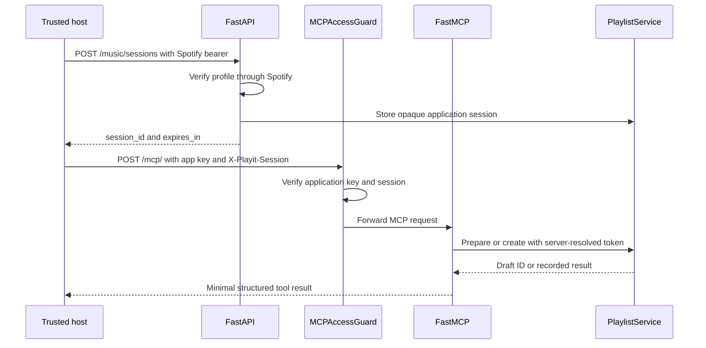

# MCP Server Explained

Related guides: [Frontend](frontend_README.md), [Backend](backend_README.md),
[LangChain and LangGraph](langchain_langgraph_README.md).

## 1. What MCP Means Here

Model Context Protocol standardizes how a host discovers and calls tools supplied
by another process. The host might contain an LLM, but MCP itself is not an LLM,
a recommendation algorithm, OAuth provider, or database.

Playit supplies a **Streamable HTTP MCP server** with two tools:

| Tool | Input | Effect | Output exposed to the model |
| --- | --- | --- | --- |
| prepare_playlist | PlaylistProposal containing independently generated titles/artists | Search the selected catalog and store a reviewable draft; no provider playlist is created | Opaque draft_id and awaiting_user_approval status |
| create_playlist | draft_id | Create only if the owner already approved through the HTTP/UI flow | draft_id and recorded creation status |

There is no MCP approval tool, catalog-search result tool, or automatic
recommendation-generation tool. There are no application-defined resources or
prompt templates in this server. The proposal schema is inferred from the typed
tool signature and shared Pydantic model.

The browser's Agent mode currently calls the internal recommendation graph
directly. It does **not** call MusicMCPClient. MCP is an additional integration
surface for trusted hosts, sharing the same playlist service and safety rules.

## 2. Files to Read in Order

| File | MCP responsibility |
| --- | --- |
| [main.py](../backend/main.py) | Owns the FastAPI lifespan and mounts guarded MCP under `/mcp`. |
| [music/mcp_server.py](../backend/music/mcp_server.py) | FastMCP configuration, tool registration, session lookup, access guard, ASGI wrapper. |
| [music/client.py](../backend/music/client.py) | Python client bootstraps a Spotify-bound music session, connects streams, initializes protocol, and prepares proposals. |
| [music/router.py](../backend/music/router.py) | Creates application sessions and exposes trusted preview/approval/create HTTP routes. |
| [music/service.py](../backend/music/service.py) | Sessions, token-bound ownership, expiry, draft storage, explicit approval, idempotent recorded creation. |
| [music/models.py](../backend/music/models.py) | Tool proposal schema and HTTP preview/result models. |
| [music/providers.py](../backend/music/providers.py) | Actual Spotify resolution and writes behind the tool. |
| [youtube/provider.py](../backend/youtube/provider.py) | Shared provider implementation, but see current session-bootstrap limitation below. |
| [spotify/web_api.py](../backend/spotify/web_api.py) | Upstream Spotify profile validation, searches, creation, URI insertion. |
| [requirements.txt](../backend/requirements.txt) | Pins MCP SDK 1.30.0; do not assume examples for a different major version are compatible. |

The empty `mcp_demo` directory, if present locally, is not an active server or
client entry point. The implementation is in `backend/music`.

## 3. Deployment and Transport



FastMCP is named `Playit Music`. Its instructions require independently generated
song names, user review/approval, and no Spotify-token requests to the model.
`stateless_http=True` means the transport does not require persistent MCP HTTP
session state. It does **not** mean the application has no state: drafts and
Playit music sessions are in-memory dictionaries.

`json_response=True` selects JSON responses for this transport configuration.
The internal `streamable_http_path='/'` is mounted below `/mcp`, producing
`http://127.0.0.1:8000/mcp/`. The FastAPI lifespan must run
`mcp.session_manager.run()`; simply importing the sub-application is not enough.

This is HTTP, not a standalone stdio server. Launching the Uvicorn application
provides the MCP endpoint; do not configure a stdio-only client to execute
`music/mcp_server.py` and expect this same deployment to work.

## 4. The Three Credentials You Must Distinguish

| Credential | Used where | Who may see it |
| --- | --- | --- |
| Spotify OAuth access token | POST /music/sessions and trusted draft HTTP requests | Browser auth memory and trusted backend/client code; never tool arguments or prompts |
| PLAYIT_MCP_API_KEY | MCP Authorization header as Bearer app key | Server deployment and trusted MCP host only |
| Playit session_id | MCP X-Playit-Session header | Trusted host/server; opaque token mapping, not an LLM tool argument |

The app key must be at least 32 characters. Store it in deployment configuration
or a local ignored environment file. A server-side generator such as
`python -c 'import secrets; print(secrets.token_urlsafe(32))'` can generate a value;
do not paste real keys into source, checked-in client JSON, chat messages, or screenshots.

`/music/sessions` currently calls Spotify's get_user and therefore bootstraps
Spotify credentials only. Although PlaylistProposal supports YouTube for shared
HTTP workflows, **a YouTube-only token is not supported by this MCP bootstrap**.
Adding YouTube MCP sessions requires an explicit provider-aware design and
matching profile validation, not just changing a proposal's provider field.

## 5. Access Guard Line by Line Conceptually

`MCPAccessGuard.__init__` stores the inner ASGI app. `__call__` receives ASGI
scope/receive/send. Non-HTTP traffic passes through. For HTTP:

1. Read the configured application key from the server environment.
2. Build a Starlette Request from scope to access headers.
3. Reject absent/short configuration with 503 rather than serving unguarded tools.
4. Constant-time compare Authorization to the expected Bearer app key; reject with 401.
5. Look up X-Playit-Session; expired/unknown application sessions reject with 401.
6. Forward only authenticated requests to FastMCP and return immediately.
7. Add Cache-Control: no-store to rejected JSON responses and send them through ASGI.

`session_token(ctx)` separately reads the actual HTTP request from the MCP tool
context, checks its type, and resolves the Playit session to a provider token.
HTTP failures become ToolError without exposing a traceback to the model.

This is a trusted/local application-key guard, **not a public MCP OAuth
authorization server**. For public hosts, implement appropriate MCP authorization,
origin/network policy, secure secret storage, account identity, and durable state.

## 6. Tool Definitions and Annotations

`@mcp.tool` registers each async function and derives its tool schema.
`ToolAnnotations` provides advisory hints; the service still enforces real checks:

| Annotation | prepare_playlist | create_playlist |
| --- | --- | --- |
| readOnlyHint | false: allocates a draft and performs searches | false: writes provider state |
| destructiveHint | false | false: creation, not deletion |
| idempotentHint | false: each call can allocate a new draft | true: same stored draft returns its recorded outcome |
| openWorldHint | true: external catalog calls | true: external playlist writes |

Preparation calls `playlist_service.prepare`, not the LangGraph recommender.
It accepts a complete externally supplied proposal, resolves it once, and returns
only draft_id/status. Creation calls `playlist_service.create`; approval cannot
be invented by supplying extra JSON fields or asking the model to confirm.

Recorded idempotency is limited to the same draft in the current process. It
does not mean arbitrary re-creation after a server restart is safe.

## 7. Start the Server

From the project root:

```sh
cd backend
source .venv/bin/activate
python -m pip install -r requirements.txt
python -m uvicorn main:app --reload
```

Configure normal Spotify OAuth settings and PLAYIT_MCP_API_KEY before startup.
The Gemini key is only needed if this deployment also uses Gemini paths; the MCP
prepare tool itself does not generate recommendations through Gemini.

The local endpoint is `http://127.0.0.1:8000/mcp/`. Use one worker because sessions,
drafts, approval, and uncertain-write outcomes are process-local. Do not restart
mid-flow and expect an old draft or session to remain accessible.

## 8. Use the Included Python Client

Run trusted Python code from the backend directory with an already-authorized
Spotify access token supplied through your secure local environment. The names
below are variables, not sample real secrets:

```python
import asyncio
import os

from music.client import MusicMCPClient
from music.models import PlaylistProposal


async def main():
    token = os.environ["SPOTIFY_ACCESS_TOKEN"]
    proposal = PlaylistProposal(
        provider="spotify",
        name="Evening Hindi Mix",
        description="A short mix for review",
        songs=[{"title": "Tum Hi Ho", "artist": "Arijit Singh"}],
        requested_count=1,
    )
    client = MusicMCPClient("http://127.0.0.1:8000")
    draft_id = await client.prepare(proposal, token)
    print({"draft_id": draft_id, "status": "awaiting_user_review"})


asyncio.run(main())
```

This searches the catalog and allocates a draft, but does not create a Spotify
playlist. `MusicMCPClient.connect` checks the app key, bootstraps a session over
HTTP, creates a separate HTTP client with MCP credentials, opens read/write
streams, constructs ClientSession, initializes it, then yields it. Async context
managers close sessions and streams when the caller exits.

`prepare` serializes the validated proposal, calls prepare_playlist, checks
isError/structuredContent, and returns the draft ID. It does not inspect the
preview or grant approval for you.

## 9. Discover and Call Tools Directly

Use the included connection helper for a real protocol handshake:

```python
async with client.connect(token) as session:
    tools = await session.list_tools()
    print([tool.name for tool in tools.tools])
    result = await session.call_tool(
        "prepare_playlist",
        {"proposal": proposal.model_dump()},
    )
    if result.isError or not result.structuredContent:
        raise RuntimeError("Preparation failed; inspect the local tool result.")
    draft_id = result.structuredContent["draft_id"]
```

The LLM only supplies proposal content. The host attaches credentials outside
the prompt and never asks Gemini to fill Authorization or X-Playit-Session.
Tool results are MCP results, not arbitrary REST JSON; inspect isError before
using structuredContent.

## 10. Review, Approve, Then Create

An external MCP host must provide a trusted review surface. The current browser
chat does not automatically import a draft created by another MCP host; there is
no draft-ID input panel or saved-draft listing in the app.

The trusted host should use the normal Spotify bearer to:

1. GET `/music/drafts/{draft_id}` and render matches, duration, warnings, and privacy.
2. Wait for an explicit human confirmation in its own UI.
3. POST `/music/drafts/{draft_id}/approve` only after that confirmation.
4. Call create_playlist via MCP, or POST the corresponding HTTP `/create` route.
5. Read the preview again to obtain the actual playlist result/link.

After the external human approval step, a trusted client can create using:

```python
async with client.connect(token) as session:
    result = await session.call_tool("create_playlist", {"draft_id": draft_id})
    if result.isError:
        raise RuntimeError("Creation rejected or needs review.")
    print(result.structuredContent)
```

Never automatically POST approval immediately after prepare. That would bypass
the human boundary even though the endpoints technically accept the request.
The endpoint requires the same exact bearer that owns the draft; refresh changes
the owner fingerprint. Constraint warnings and zero matches block approval.

## 11. Connect Another MCP Host or Inspector

Choose Streamable HTTP with URL `http://127.0.0.1:8000/mcp/`. The host must support
custom headers and a server-side way to refresh the Playit application-session
handle. Conceptually its connection settings need:

```json
{
  "transport": "streamable-http",
  "url": "http://127.0.0.1:8000/mcp/",
  "headers": {
    "Authorization": "Bearer <server-side-application-key>",
    "X-Playit-Session": "<fresh-application-session-id>"
  }
}
```

This is a conceptual connection description, not a promise that every host uses
these exact configuration keys. Use that host's input/environment-secret syntax;
do not commit substituted values. Session_id comes from POST /music/sessions,
not from guessing a token or copying a provider bearer into that header.

For manual inspection, an MCP Inspector compatible with Streamable HTTP can be
launched separately (for example `npx @modelcontextprotocol/inspector`). Configure
the same URL and both headers in its trusted local connection settings. Initialize,
list tools, inspect schemas, and try prepare. This is optional tooling, not a new
application dependency. Avoid sharing Inspector logs containing headers.

## 12. Safe Experiments and Troubleshooting

| Experiment/symptom | Expected behavior or next step |
| --- | --- |
| List tools after initialize | prepare_playlist and create_playlist are discoverable. |
| Prepare a one-song proposal | Draft/status only; no provider playlist write. |
| Call create before human approval | Tool error because service rejects unapproved draft. |
| App key absent/too short | 503; MCP is deliberately disabled. |
| Wrong app key | 401 at the access guard. |
| Missing/expired session header | 401; bootstrap a fresh Spotify application session. |
| Draft 404 | Expired, wrong owner token, different worker, or server restart. |
| Approval 409 | No usable matches or unmet explicit constraints. |
| needs_review | A write may have succeeded; inspect provider and recorded result, do not re-create blindly. |
| Wrong transport | This app mounts HTTP, not stdio. |
| Session manager error | Ensure the FastAPI lifespan starts mcp.session_manager. |
| YouTube-only bootstrap failure | Current /music/sessions verifies Spotify; provider-aware MCP auth is not implemented. |

Drafts expire after 15 minutes; Playit application sessions after 50 minutes;
each dictionary is bounded to 500 entries. These are separate from provider token
expiry and from any protocol-level session concept. Provider writes are not
automatically retried or rolled back. No new test files are part of this guide.

## 13. How to Extend It

Add a tool only when its input/output, credential boundary, side effects, and
approval requirements are clear. Prefer calling the existing PlaylistService
rather than duplicating provider writes. Never expose `approve` as an LLM tool.
Do not return raw catalog matches to the model merely because the HTTP UI can
read them. New providers require adapters, provider-aware bootstrap/auth,
validation, and host review presentation. Public deployment requires a different
authorization and persistence design, not just a longer shared key.